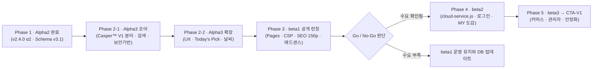

# Coffee Taste Archive 통합 로드맵 v3.1 (Phase 1~5)

- **작성일:** 2026-11-19 (v3.1 업데이트 — Phase 1 완료 · 감사 보고서 반영 · 엔진명 `Casper` 변경)
- **현재 기준:** `CTA v2.4.0 (α2)` · `Schema v3.1`
- **엔진 명칭:** 기존 `DispenserV2 ™` → **`Casper`** (`casper.js` · Phase 2-1에서 **`Casper™ V1`** 승격)
- **참고한 자료**
  1. 노션 기획 페이지 (Block 0~4, 수정사항 모음, Sketch idea, 바리스타 추천 기준)
  2. Google Sites 아키텍처 보고서 1편(v1~v2.1.3) 및 2편([v2.1.4~v2.3.0 α1 저장소 감사 보고서](https://sites.google.com/view/project-catv214v2301/full-page-embed))
  3. 현재 실측 코드 (`index.html` 6,732줄 · `data.js` 1,650줄 · `version.js` · `bump-version.js`)
  4. 수익화 계획 (애드센스, 제휴 링크)

> [!IMPORTANT]
> **v3.1에서 바뀐 핵심 내용**
> 1. **엔진 리브랜딩 (`Dispenser` → `Casper`):** 분리될 검색·큐레이션 엔진 파일명과 브랜드 명칭을 `dispenser.js` / `DispenserV3 ™`에서 **`casper.js` / `Casper™ V1`**로 전면 변경했습니다. (기존 `localStorage` 키 `dispenser_*`는 하위 호환 읽기·자동 마이그레이션 유지)
> 2. **Phase 1 완료 반영 (`CTA v2.4.0 α2` · `Schema v3.1`):** 데이터 신뢰도(가짜 문구 0건), EN/JP 한국어 0건, WCR 품종 정규화, 3축/5축 레이더 차트, 버그 9건, `html2canvas` SRI, 시음 날짜 보존이 이미 완료되었습니다.
> 3. **Phase 2 분할 (`2-1` / `2-2`) 및 회귀 방어 강화:** `index.html` 6,732줄 분리 시 `v2.1.8~v2.1.9` 모바일·카카오톡 인앱 안정화 코드가 깨지지 않도록 `boot.js`(0프레임 FOUC) 분리와 회귀 체크 4종, 보고서 실측 검색 실패 3유형을 Gate 2-1에 고정했습니다.
> 4. **보안·거버넌스 조기화:** Git Tag 전환과 `bump-version.js` 다중 파일 동기화를 Phase 2-1로, HTTP CSP 1차 적용을 Phase 3(공개 런칭)으로 앞당겼습니다.

---

## 0. 지금 상태 진단 (`CTA v2.4.0 α2` · `Schema v3.1`)

### 노션 기준 진행률

| Block | 출시 명칭 | 진행 상태 |
|---|---|---|
| Block 0 · 서비스 이름과 대상 | — | 🟡 주 사용자(입문자·마니아 균형)·단맛 정책·엔진명(`Casper`) 확정 / 서비스 이름 최종 확정 대기 |
| Block 1 · 맛 DB와 탐색 기능 (MVP) | **Alpha1** | ✅ 완료 |
| Block 2 · 인터랙티브와 콘텐츠 | **Alpha2** | ✅ **Phase 1 완료 (`CTA v2.4.0 α2` · `Schema v3.1`)** |
| Block 2 후반부 (엔진·검색·날씨) | **Alpha3** | ⬜ **다음 착수 단계 (Phase 2-1 → 2-2)** |
| Block 3 · 호스팅·수익화·로그인·커머스 | beta1~3 → CTA-V1 | ⬜ 시작 전 |
| Block 4 · 관리자 페이지 (Admin CMS) | — | ⬜ 시작 전 |

### 현재 코드 실측 현황 (`v2.4.0 α2`)
- **코드 규모:** `index.html` **6,732줄(300 KB)** + `data.js` **1,650줄(241 KB)** = 총 8,382줄 → 단일 HTML 유지보수 한계 도달, **`casper.js` 분리 최우선**
- **Phase 1 선해결 완료:** 120종 추적성(실명 `ESTATE_LOT` 42 · 지역 `REGIONAL_GRADE` 53 · 아키타입 16 · 검증대기 `PENDING_VERIFICATION` 9, 가짜 문구 0건), EN/JP 한국어 혼입 0건, WCR 품종 정규화, `html2canvas@1.4.1` SRI, 시음 날짜 영구 보존(`dispenser_tasted_records`), Block 2 버그 9건
- **Phase 2-1 착수 전 잔여 정리:** `data.js` 2행 `[Schema v2]` 주석 잔존, 저장소 내 버전별 스냅샷 폴더 규칙 통일 및 Git Tag(`v2.4.0-alpha2`) 전환, 노션 Block 2 체크리스트 수동 동기화

---

## 전체 흐름



| Phase | 노션 Block | 출시 명칭 | 기간 (예상) | 내부 버전 | 스키마 | 엔진 | 공개 여부 | 예상 추가 비용 |
|---|---|---|---|---|---|---|---|---|
| **1** | Block 0, Block 2 잔여 | **Alpha2** | ✅ 완료 (2026-11-19) | `v2.4.0 (α2)` | `v3.1` | 내장 V2 | 비공개 테스트 | 0원 |
| **2-1** | Block 2 (엔진·검색) | **Alpha3 (코어)** | 11-20 ~ 12-08 | `v2.5.x (α3)` | `v3.2` | **`Casper™ V1`** | 비공개 테스트 | 0원 |
| **2-2** | Block 2 (UX·날씨) | **Alpha3 (확장)** | 12-09 ~ 12-31 | `v2.6 ~ v2.9 (α3)` | `v3.3 ~ 3.4` | **`Casper™ V1`** | 비공개 테스트 | 0원 (Workers 무료) |
| **3** | Block 3 앞부분 | **beta1** | 2027-01-01 ~ 01-31 | `v3.0.0 (β1)` | `v3.5` | `Casper™ V1` | **공개 런칭** | 도메인 연 ~1.5만 원 |
| **Gate** | — | — | 2027-03 초 | — | — | — | — | — |
| **4** | Block 3 중간, Block 4 일부 | **beta2** | 03 ~ 04 | `v3.5.0 (β2)` | **`v4`** | `Casper™ V1` | 비공개 (`beta1` 유지) | 0원~ (Supabase 증설 시 월 \$25~) |
| **5** | Block 3 후반부, Block 4 | **beta3 → CTA-V1** | 05 ~ 06 | `v3.9 (β3)` → **`v4.0.0`** | `v4.x` | `Casper™ V1+` | **정식 공개** | 위 유지 (알림톡 시 건당 과금) |

> [!NOTE]
> 정식 공개 명칭 **CTA-V1**은 내부 버전 `v4.0.0`에 해당합니다. 사용자에게는 `"CTA-V1"`과 `"powered by Casper™ V1"` 시그니처를 중심으로 보여 주고, 내부 버전 번호는 버전 기록 창에서 표시합니다.

---

## Phase 1 · Alpha2 완성 (`CTA v2.4.0 α2` · `Schema v3.1`) — ✅ 코드 완료

### 1-A. Block 0 · 서비스 정체성
- [ ] **서비스 이름 최종 확정:** `"SCA"` 표현 제외, `.com`/`.kr` 도메인·키프리스 상표 확인 후 확정 (`CTA_BRAND_CONFIG` 상수화 완료 → 확정 즉시 일괄 교체 가능)
- [x] **주 사용자 정의 (확정):** 입문자·마니아 균형 — 기본 3축 간단 뷰 vs `'자세히'` 5축·단맛 확장 뷰 (`localStorage.cta_detail_mode`)
- [x] **엔진 명칭 변경 (확정):** `Dispenser` → **`Casper`** (`Phase 2-1` 분리 시 `casper.js` / `Casper™ V1` 공식 적용)

### 1-B ~ 1-E. 데이터 · 기능 · 버그 · 보안 (완료 내역)
- [x] **데이터 신뢰도 (`Schema v3.1`):** `PENDING_VERIFICATION` 신설, 가짜 자동 생성 문구 0건, 49종 3그룹 감사(`docs/traceability_audit_49.csv` · 실명 +20종→42종 / 지역 +20종→53종 / 대기 9종), 오타 2건 정정(`bur-03` 부신데, `png-03` 코르구아), WCR 품종 정규화, EN/JP 한국어 혼입 0건
- [x] **Block 2 잔여 기능:** 3축/5축 인라인 SVG 레이더 차트 + 단맛 토글, 원두별 추출 온도 주의(안내문 2), 추출 방식별 맛 변화 가이드(안내문 4), 종이 질감 배경(`Ui`), 4대 카테고리 재분류(`UI3`), 주관 평가·제휴 고지 블록
- [x] **버그 9건 전수 수정:** 시음 날짜 보존(`dispenser_tasted_records`), 모달 `✕` 버튼, 모바일 휠 라이브 콜아웃, 라이트 모드 증기, `'블렌드'`·`'ㅋㄹㅂㅇ'` 검색 일치, 타종 토스트·레버 스크롤·크래프트 절취선 모션
- [x] **보안·버전 체계:** `html2canvas@1.4.1` SRI 해시, `scripts/bump-version.js --stage` 지원, `CTA v2.4.0 (α2)` · `Schema v3.1` 동기화
- [ ] **노션 Block 2 체크리스트 수동 동기화** (Phase 1 완료 요약 반영)

---

## Phase 2 · Alpha3 (`Casper™ V1` 엔진 분리 + 검색 + UX + 날씨 추천)

> [!IMPORTANT]
> **v3.1 핵심 조정:** `index.html`이 6,732줄(300KB)까지 커졌고 `v2.1.8~v2.1.9` 현장 안정화 코드가 강결합되어 있어, 리팩토링과 신기능을 한 번에 섞으면 회귀 버그 위험이 높습니다. Phase 2를 **2-1(엔진 분리·검색·보안기반)**과 **2-2(UX·Today's Pick·날씨)**로 분할해 안전하게 진행합니다.

### Phase 2-1 · `Casper™ V1` 분리 · 검색 코어 · 보안 기반 (`v2.5.0 α3` · `Schema v3.2`)

#### 2-1A. 착수 전 거버넌스 정리
- [x] **Git Tag 체계 전환:** 현재 `CTA v2.4.0 (α2)` 기준 Git Tag(`v2.4.0-alpha2`) 생성, 버전별 스냅샷 폴더 복제 중단
- [x] **`data.js` 2행 주석 정합화:** 잔존 `[Schema v2]` 주석을 `[Schema v3.2]`로 정정
- [x] **`scripts/bump-version.js` 다중 파일 확장:** 기존 `version.js?v=`, `data.js?v=` 외에 분리되는 `styles.css?v=`, `boot.js?v=`, `casper.js?v=`, `app.js?v=` 캐시 쿼리까지 자동 동기화

#### 2-1B. 모듈 분리 & `Casper™ V1` 승격 (`file://` 호환 유지)
- [x] `index.html` (6,732줄 → 마크업 중심 1,500~2,500줄 수준 경량화)을 역할별 정적 파일로 분리:
  - `styles.css` — 전체 테마·택타일·시소 탭·모바일 레이아웃 스타일
  - `boot.js` — **0프레임 크래프트 박스 FOUC 방지용 초경량 동기 외부 스크립트** *(인라인 `<script>` 0개와 FOUC 방지를 동시에 달성)*
  - **`casper.js`** — **`Casper™ V1`** 순수 검색·토크나이저·초성 인덱스·4축 매칭·큐레이션 코어 (DOM 비의존, 단독 단위 테스트 가능)
  - `app.js` — UI 렌더링, `AudioFX`, `isValidMobileTap()`, 영수증 캔버스·카카오톡 인앱 미리보기 모달
  - `data.js` — Phase 4 CMS 자동 생성을 대비해 **순수 원두·산지 데이터**와 **스키마 부트스트랩/정규화 로직**의 경계를 명확히 분리
- [x] **엔진 브랜딩 전환:** `version.js`의 `engineName`을 `"DispenserV2 ™"` → **`"Casper™ V1"`**로 승격, UI 하단 시그니처(`powered by Casper™ V1`) 및 내부 객체 네임스페이스(`window.CasperEngine`) 정비 *(단, 기존 `localStorage` 키 `dispenser_*`는 읽기 하위 호환 유지)*
- [x] **보안 기반 구축:** 인라인 `onclick` 및 인라인 `<script>` **0개** 달성, 이벤트 위임 전환, 동적 HTML 렌더링 전수 `escapeHtml()` 적용

#### 2-1C. `Casper™ V1` 검색 고도화
- [x] **보고서 실측 검색 실패 3유형 + 다중어·오타 근본 해결:**
  1. 2어절 이상 공백 복합어 (`"에티오피아 워시드"`, `"콜롬비아 게이샤"`)
  2. 외래어 표기 오타·유사음 (`"슈프리모"` ↔ `"수프리모"`, `"예가체프"` ↔ `"예가체페"`)
  3. 향미 노트 초성 검색 (`"ㅂㅅㅇ"` → 복숭아, `"ㅂㄹㅂㄹ"` → 블루베리)
- [x] **생산자·농장·워싱스테이션 이름 검색** (`Sigri`, `Attikan`, `Gesha Village` 등 한·영·일 대응)
- [x] **실시간 자동완성** (노션 Alpha3) — 원두명·산지·향미·생산자 추천 드롭다운
- [x] **검색 기록** (노션 Alpha3) — `localStorage` 최근 10개 저장, 개별·전체 삭제 버튼
- [x] **`Casper™ V1` 검색 회귀 테스트 세트 50개** 구축 및 CLI 자동 검증 (`'블렌드'`, `'ㅋㄹㅂㅇ'`, `'에티오피아 워시드'`, `'슈프리모'`, `'ㅂㅅㅇ'` 필수 포함)

#### 완료 기준 (Gate 2-1)
- [x] `Casper™ V1` 검색 회귀 테스트 50개 100% 통과
- [x] 인라인 이벤트 핸들러(`onclick=` 등) 및 인라인 `<script>` **0개**
- [x] **`v2.1.8~v2.1.9` 모바일·인앱 회귀 테스트 4종 통과:** `isValidMobileTap()` 스크롤 사운드 차단, 카카오톡 인앱 RGB 미리보기 모달(`#ticketImagePreviewOverlay`) & 외부 브라우저 열기, `boot.js` 0프레임 크래프트(FOUC 없음), `file://` 로컬 실행 정상

---

### Phase 2-2 · UX 확장 · Today's Pick · 날씨 추천 (`v2.6 ~ v2.9 α3` · `Schema v3.3 ~ 3.4`)

#### 2-2A. 사용성 (노션 Alpha3 UI 항목)
- [x] **Ui6 튜토리얼:** 첫 방문 시 3단계 인터랙티브 안내 (레버 → 휠 → 도감)
- [x] **Ui7 간단 / 자세히 첫 진입 모드 선택:** 입문자(간단 3축) · 마니아(자세히 5축·단맛·추출 스펙) 선택 온보딩 제공, Phase 1의 `localStorage.cta_detail_mode`와 즉시 연동
- [x] **커피 두 개 비교 기능** (노션 Sketch idea): 두 원두의 3축/5축 SVG 레이더 차트를 겹쳐서 비교
- *(참고: `Ui8` 머신·검색창 정사각형 회전은 모바일 레이아웃 회귀 리스크로 **CTA-V1 이후 백로그**로 이동)*

#### 2-2B. Today's Pick과 날씨 추천 (`weather-service.js`)
- [x] **(pre) 바리스타 추천 기준표 작성:** 날씨·기온·시간대별 `Casper™ V1` 추천 가중치 규칙 정의
- [x] **Today's Pick 1단계 (무API):** 날짜·계절·시간대(오전·점심·저녁) 기반 추천
- [x] **Today's Pick 2단계 (날씨 연동 — `weather-service.js` 분리):**
  - 데이터: **기상청 단기예보 API** (무료, 상업적 이용 가능)
  - API 키 보호: **Cloudflare Workers 프록시** (무료 구간), 격자별 1시간 캐시
  - 위치: **도시·구 선택 기본**, GPS는 선택 사항 (위치정보법 부담 최소화)
  - 추천 문구: *"비 오고 흐린 오늘, 바리스타는 묵직한 인도네시아 만델링을 추천해요"*

#### 2-2C. DB 검수 & 다이얼링 노트 (노션 DB2 · DB3 압축 정비)
- [x] **실명 42종 영·일 카피 검수:** Phase 1에서 한국어 혼입 0건을 달성한 EN/JP 문구 중 핵심 마이크로랏 42종의 현지화 자연스러움 다듬기
- [x] **SCA CVA 용어 정교화:** 기존 WCR 품종 정규화(Phase 1 완료)에 더해 커핑 용어·추출 가이드 정교화
- [x] **바리스타 다이얼링 노트 필드 추가:** 원두별 분쇄도·물온도·추출 팁 1줄 코멘트

#### 완료 기준 (Gate 2-2 · Alpha3)
- [x] Today's Pick이 날씨 API 장애/오프라인 시에도 시간대 추천으로 자연스럽게 폴백
- [x] `Ui6` 튜토리얼, `Ui7` 모드 선택, 2종 비교 기능이 데스크톱·모바일 모두 정상 동작
- [x] EN/JP 모드 한국어 혼입 0건 유지 + 실명 42종 번역 검수 완료

---

## Phase 3 · beta1 공개 런칭 (`v3.0.0 β1` · `Schema v3.5`)

**목표:** 호스팅·커스텀 도메인·HTTP CSP 보안·SEO 정적 150페이지·애드센스·로컬 다중 시음 기록을 완성해 서비스를 공식 공개합니다.

### 3-A. 호스팅 · 브랜치 분리 · HTTP CSP 조기 적용
- [ ] **커스텀 도메인 구매** (Block 0 확정 이름 기준 — 애드센스 최상위 도메인 소유 검증 필수)
- [ ] **호스팅 최종 확정 (Cloudflare Pages 1순위):** Phase 2-2의 Cloudflare Workers(기상청 프록시)와 동일 플랫폼 통합 시 CORS·`_headers` CSP·Web Analytics 관리에 압도적 유리
- [ ] **운영/테스트 환경 분리:** `main` 브랜치 → 공개 사이트(`beta1` 유지), `develop` 브랜치 → 비공개 미리보기(`beta2` 개발)
- [ ] **HTTP CSP 1차 적용 (Phase 5 → Phase 3 조기화):** Phase 1 SRI와 Phase 2 인라인 스크립트 0개를 기반으로 Cloudflare Pages `_headers`에 `Content-Security-Policy` 헤더 적용 (`'self'`, `cdnjs.cloudflare.com` `html2canvas`, 기상청 Workers 도메인, 애드센스 도메인만 허용)

### 3-B. SEO · 트래픽 향상 (노션 스키마 세부화)
- [ ] **정적 페이지 생성 스크립트(`scripts/build-seo-pages.js`) 도입:**
  - 원두별 정적 페이지 **120개** + 산지별 정적 페이지 **30개** (`originData` 실측 27개 산지 + 3대 특별 테마 = 총 **150개** 고유 페이지)
- [ ] **구조화 데이터(JSON-LD) 정비:**
  - 가격(`offers`) 없는 원두 카드의 `Product` 경고를 막기 위해 **`Article` / `CreativeWork`** 적용 (제휴 링크 연동 원두만 `offers` 선택 부여)
  - `"SCA"` 브랜드 표기 제거, FAQ 스키마 10개 이상 확장
- [ ] `sitemap.xml`, `robots.txt` 생성 및 구글 서치콘솔 · 네이버 서치어드바이저 등록

### 3-C. 수익화 1 (애드센스 · 제휴 링크)
- [ ] 고유 콘텐츠 150페이지 확보 + **개인정보처리방침(광고 쿠키 고지)** · 서비스 소개 · 문의 페이지 개설
- [ ] 광고 슬롯은 상세 페이지 하단과 목록 사이에만 배치 (`Casper` 휠·레버 핵심 인터랙션 영역 배제)
- [ ] 제휴 링크(쿠팡 파트너스 등) 연동 및 공정위 고지 문구(Phase 1 `.modal-disclosure-note`) 최종 문안 반영

### 3-D. 로그인 없는 다중 시음 기록 (MY 맛 도감 1단계)
- [ ] 기록 구조: `cta_tasting_logs_v2` → `[{ logId, beanId, tastedAt, rating, brewMethod, roastery, memo }]` (같은 원두 다회 기록 가능)
- [ ] **2단계 자동 마이그레이션 보장:** `dispenser_tasted_set`(레거시 ID 배열) → `dispenser_tasted_records`(v2.4 날짜 객체) → `cta_tasting_logs_v2`(v3.0 다중 로그) 무손실 이전
- [ ] JSON 내보내기 / 가져오기 (기기 변경 백업)

### 3-E. 측정과 접근성
- [ ] Cloudflare Web Analytics (무쿠키 방문 분석) + 원두 조회수·제휴 클릭률 측정 기반 마련
- [ ] `user-scalable=no` 제거, ARIA 속성 보강

### 완료 기준 (Gate 3 · beta1 공개)
- 커스텀 도메인 + HTTP CSP 헤더 적용 상태로 서비스 공개, 원두·산지 150페이지 색인 개시
- 애드센스 신청 완료, `main`(공개) / `develop`(비공개) 브랜치 분리 운영

---

## Go / No-Go 판단 (2027년 3월 초, beta1 공개 후 4~6주)

| 지표 | 진행 기준 (예시) |
|---|---|
| 월간 방문자(MAU) | 3,000명 이상 |
| 시음 기록 사용자 비율 | 방문자의 10% 이상 |
| 애드센스·제휴 수익 | 월 서버 비용(약 \$25) 감당 수준 |
| "기기 간 동기화" / "로그인" 요청 | 꾸준히 발생 |

기준 미달 시 `beta1`을 유지하며 분기별 DB 업데이트와 SEO 강화에 집중합니다.

---

## Phase 4 · beta2 (`v3.5.0 β2` · `Schema v4` — 로그인 · `cloud-service.js` · 개인화 · CMS)

**목표:** 공개 사이트(`beta1`)를 유지한 채 `develop` 환경에서 소셜 로그인, 클라우드 동기화(`cloud-service.js`), 개인화 추천, 가벼운 CMS를 구축합니다.

### 4-A. `cloud-service.js` (Local-First 어댑터) & 소셜 로그인
- [ ] **Local-First 저장소 계층(`cloud-service.js`) 도입:** `app.js`는 공통 저장 인터페이스만 호출 (비로그인 = `localStorage`, 로그인 = `localStorage` + Supabase 백그라운드 동기화)
- [ ] Supabase Auth 기반 **카카오·구글** 소셜 로그인 (비로그인 상태에서도 모든 탐색·기록 기능 100% 유지)

### 4-B. MY 맛 도감 클라우드 동기화
- [ ] 로컬 다중 기록을 `client_log_id` 기준으로 병합(충돌 시 최신 `updated_at` 우선)
- [ ] **레거시 중복 방지:** Phase 1~3에서 마이그레이션된 구버전 도장 기록은 `legacy-${beanId}-${displayDate}` 형태의 **결정론적(deterministic) `client_log_id`**를 부여해 재로그인 시 중복 행 생성 차단
- [ ] 개인 통계: 마신 원두 지도, 선호 산미·고소함·바디·단맛 프로파일
- [ ] DB 스키마(`UNIQUE(user_id, client_log_id)` + RLS):

```sql
CREATE TABLE public.user_tasting_logs (
  id UUID PRIMARY KEY DEFAULT gen_random_uuid(),
  user_id UUID NOT NULL REFERENCES auth.users(id) ON DELETE CASCADE,
  client_log_id TEXT NOT NULL,                  -- 로컬 logId / legacy-${beanId}-${displayDate}
  bean_id TEXT NOT NULL CHECK (char_length(bean_id) <= 32),
  tasted_at TIMESTAMPTZ NOT NULL,
  rating SMALLINT CHECK (rating BETWEEN 1 AND 5),
  brew_method TEXT CHECK (brew_method IN ('HAND_DRIP','ICED_DRIP','ESPRESSO','COLD_BREW','CAFE')),
  roastery TEXT CHECK (char_length(roastery) <= 60),
  personal_note TEXT CHECK (char_length(personal_note) <= 300),
  weather_snapshot JSONB,                       -- 기상 상태·기온만 저장 (GPS 좌표 저장 금지)
  updated_at TIMESTAMPTZ NOT NULL DEFAULT now(),
  UNIQUE (user_id, client_log_id)
);

ALTER TABLE public.user_tasting_logs ENABLE ROW LEVEL SECURITY;

CREATE POLICY "own_logs_only" ON public.user_tasting_logs
  FOR ALL TO authenticated
  USING (auth.uid() = user_id)
  WITH CHECK (auth.uid() = user_id);
```

### 4-C. 커피 선호도와 개인화 (`Casper` 추천 확장)
- [ ] **인기 순위:** 원두별 조회수 일 단위 집계 (Supabase 함수, 개인정보 미저장)
- [ ] **규칙 기반 개인화 추천:** 높은 별점을 준 원두의 맛 4축 평균과 가까운 원두를 `Casper` 엔진 가중치로 추천

### 4-D. 관리자 기능 1단계 (가벼운 CMS)
- [ ] **구글 시트 / 노션 DB → `data.js` 자동 생성 스크립트:** Phase 2-1에서 분리한 순수 데이터 영역만 생성하도록 구성해 수동 편집 오류 차단
- [ ] **운영 대시보드 1단계:** Cloudflare 분석 + Supabase 통계로 인기 검색어·맛 선호·제휴 클릭률 확인

### 4-E. 클라우드 고유 보안 & 법적 요건
*(SRI는 Phase 1, `escapeHtml`·인라인 제거는 Phase 2-1, 1차 HTTP CSP는 Phase 3에서 선행 완료)*
- [ ] **Supabase RLS 침투 테스트** (타 사용자 `user_id` 읽기·수정·삭제 차단 검증)
- [ ] **OAuth 리다이렉트 화이트리스트** 검증, HTTP CSP에 Supabase 도메인 추가
- [ ] 사용자 입력(`roastery`, `personal_note`) 클라이언트·DB 이중 검증 및 저장형 XSS 차단
- [ ] `weather_snapshot` 내 GPS 위경도 미저장 감사 + 개인정보처리방침 개정·이용약관·회원 탈퇴 즉시 삭제 구현

### 완료 기준 (Gate 4 · beta2)
- 두 기기 간 동기화·중복 병합 정상, RLS 침투 테스트 통과
- 개인정보처리방침·이용약관 게시, 개인화 추천 클릭률 > 일반 추천 (A/B 확인)

---

## Phase 5 · beta3 → CTA-V1 (`v3.9 β3` → `v4.0.0`, Block 3 후반부 + Block 4)

### 5-A. 커머스 연계 (현실적 대안)
- [ ] **네이버 쇼핑 검색 API** (일 1회 캐시) · **쿠팡 파트너스 API** · **직접 제휴 로스터리(3~5곳, 구글 시트 연동)** 조합

### 5-B. 주변 카페 지도 (범위 축소)
- [ ] **제휴 카페 한정 카카오맵 API** 표시 (도시 선택/지도 이동 기본, 제휴 10곳 미만이면 V1 이후로 연기)
- [ ] 팝업스토어·제휴 카페 QR 원두 카드 연계

### 5-C. 최종 보안 · 안정화 · 운영 체계
- [ ] HTTP CSP 최종 점검(커머스·지도 도메인 포함), API 요청 제한(Rate Limit), 관리자 Supabase MFA
- [ ] 업타임 모니터링 + Supabase 오류 알림(슬랙·이메일 우선, 알림톡은 이후 검토), 관리자 권한 분리, 원산지 아티클 발행 흐름
- [ ] `beta3` 공개 → **2주 유지보수 기간** (🔴 높음 버그 0건) → **`CTA-V1` 정식 공개** (`v4.0.0`, 6월 뉴크롭 업데이트 동시 출시)

---

## CTA-V1 이후 백로그

| 항목 | 출처 | 메모 |
|---|---|---|
| 사진 분석으로 원두 추천 | 노션 Block 2 | 비전 AI 호출 비용 이슈 → 로그인 사용자 전용 |
| 디개싱 스탬프 | 노션 바리스타 추천 기준 | 로스팅 날짜 입력 시 피크 타이밍 스티커 표시 |
| **Ui8 머신·검색창 정사각형 회전** | 노션 Alpha3 (v3.1에서 이동) | 모바일·카톡 안정성 리스크로 별도 시안 검증 후 진행 |
| 웹 진입 전 애니메이션 고도화 | 노션 Sketch idea | 레퍼런스 확정 후 진행 |
| 블렌드 커피 표기·전용 탭 여부 | 노션 Sketch idea | 사용자 피드백 기반 결정 |
| 전용 관리자 웹 페이지 | 노션 Block 4 | 구글 시트 CMS로 한계가 올 때 전환 |

---

## 부록 A. 노션 항목 → Phase 매핑표

| 노션 항목 | 상태 | 배치 |
|---|---|---|
| Block 0 서비스 이름 / 주 사용자 | 이름 대기 · 사용자 확정 | **Phase 1** (이름은 Phase 3 도메인 전 확정) |
| Block 1 전체 | 완료 (STT 제거됨) | — |
| B2 도감 카드·`?` 가이드·안내문 2·4·`Ui`·`Ui2`·`UI3`·버그 9건 | **완료 (`v2.4.0 α2`)** | **Phase 1** ✅ |
| B2 검색 엔진 3 (엔진 분리, `Casper™ V1`, v2.5) | 미완료 | **Phase 2-1** |
| B2 자동완성, 검색 기록, 검색 버그 근본 해결 | 미완료 | **Phase 2-1** |
| B2 `Ui6` 튜토리얼, `Ui7` 간단/자세히, 2종 비교, `Today's Pick`, 날씨 API | 미완료 | **Phase 2-2** |
| B2 `DB2`(SCA 고도화), `DB3`(영·일 검수), 다이얼링 노트 | 일부 완료 (Phase 1) | **Phase 2-2** (검수·보강) |
| B2 `Ui8` 정사각형 회전, 사진 분석 | 미완료 | **V1 이후** |
| B3 웹 호스팅·CSP·애드센스·SEO 150p·로컬 다중 로그 | 미완료 | **Phase 3** |
| B3 로그인·`cloud-service.js`·MY 맛 도감·개인화·인기 순위 | 미완료 | **Phase 4** |
| B3 커머스·제휴 카페 지도·안정화·2주 유지보수 | 미완료 | **Phase 5** |
| B4 가벼운 CMS·운영 대시보드 → MFA·장애 알림 | 미완료 | **Phase 4 → Phase 5** |

## 부록 B. v3.1 주요 조정 요약 (감사 보고서 및 `v2.4.0` 실측 반영)

| 항목 | 이전 계획 (v3.0 / 보고서) | 로드맵 v3.1 확정 | 조정 이유 |
|---|---|---|---|
| **엔진 명칭** | `DispenserV2/V3 ™` (`dispenser.js`) | **`Casper™ V1` (`casper.js`)** | 브랜드 정체성 강화 (`localStorage` `dispenser_*` 키는 하위 호환 유지) |
| **Phase 2 구조** | 단일 단계에 분리+UX+날씨 혼재 | **`2-1`(분리·검색·보안) / `2-2`(UX·날씨) 분할** | 6,732줄 HTML 분리 시 리팩토링과 신기능 충돌·회귀 방지 |
| **0프레임 크래프트 vs 인라인 0개** | 단순 인라인 스크립트 금지 | **초경량 동기 `boot.js` 외부 파일 분리** | CSP 준수(인라인 0개)와 FOUC 방지(`v2.1.8`) 동시 달성 |
| **모바일·카톡 회귀 검증** | Gate 2 미명시 | **Gate 2-1에 4종 회귀 체크 고정** | `v2.1.8~v2.1.9` 안정화 자산 손실 차단 |
| **Git Tag · `bump-version.js`** | Phase 3 정리 | **Phase 2-1 착수 전 선적용 + 다중 파일 `?v=` 동기화** | 다중 파일 분리 시 폴더 복제 방식 한계 해결 |
| **HTTP CSP 헤더** | Phase 4(보고서) / Phase 5(v3.0) | **Phase 3(공개 런칭) 1차 적용** | 외부 트래픽·애드센스 노출 시점에 즉시 보안 경계 확보 |
| **산지 정적 페이지 수** | 28개 | **30개** (27개 산지 + 3대 테마 = 총 150p) | 현재 `originData` 실측 30개 카테고리 반영 |
| **클라우드 저장 구조** | Phase 4 직접 연동 | **`cloud-service.js` Local-First + 결정론적 `legacy-` ID** | 비로그인 호환성 유지 및 최초 로그인 중복 행 차단 |

## 부록 C. 의사결정 현황

| # | 항목 | 상태 | 결정 내용 / 보류 사유 | 영향 범위 |
|---|---|---|---|---|
| 1 | **주 사용자(타깃)** | ✅ 확정 | 입문자·마니아 균형 — 첫 진입 시 모드 선택 제공 | Phase 1·2-2 (`Ui7`) |
| 2 | **단맛(`sweetDots`) 처리** | ✅ 확정 | 데이터 유지, 기본 3축 / `'자세히'` 모드 5축·단맛 표시 | Phase 1 완료 · Phase 2-2 연동 |
| 3 | **검색·큐레이션 엔진명** | ✅ 확정 | `Dispenser` → **`Casper`** (`casper.js` / `Casper™ V1`) | Phase 2-1 이후 전 구간 |
| 4 | **호스팅 선택** | ⏳ Phase 2-2 후 확정 | Cloudflare Pages 1순위 (Workers 프록시와 통합 유리) | Phase 3 이후 인프라·CSP |
| 5 | **서비스 이름** | ⬜ 추후 결정 | `"SCA"` 제외, 도메인·상표 확인 (`CTA_BRAND_CONFIG` 준비 완료) | Phase 3 도메인·애드센스 |
| 6 | **제휴 로스터리·카페 계획** | ⬜ 추후 결정 | 직접 섭외 여부에 따라 기능 범위 조정 | Phase 5 커머스·카페 지도 |
